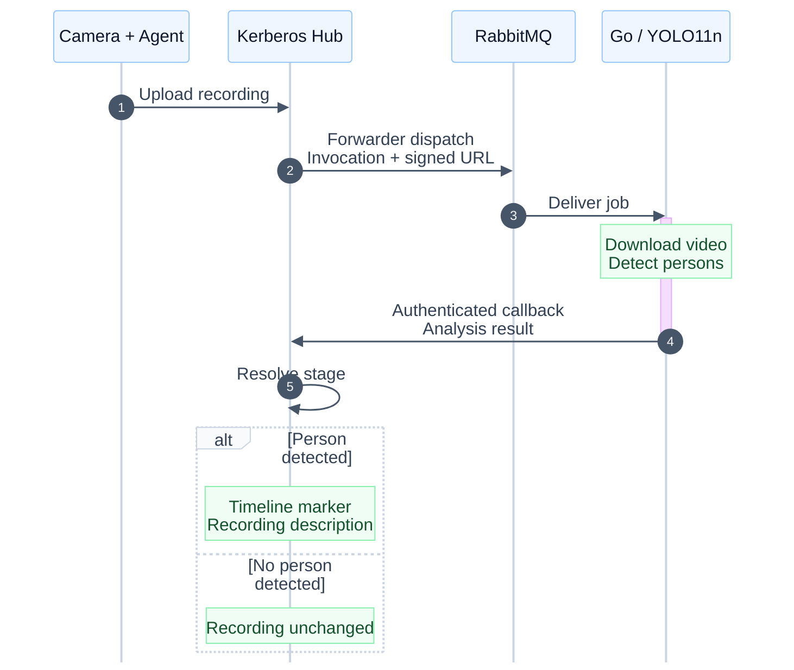

# Augment Vision Workflow Exercise

## Goal of the exercise

The goal of this exercise is to help a learner understand the complete Augment
Vision product flow: how video is captured at the edge, stored and orchestrated
through Hub, processed by a custom machine-learning stage, and enriched with
structured feedback that makes recordings searchable and filterable.

By completing the exercise, the learner should be able to:

- explain how Agent, Hub, workflows, RabbitMQ, custom processing stages, and
  workflow callbacks fit together;
- configure and run a working end-to-end workflow;
- process a Hub recording with a custom ML model;
- return markers and media metadata to Hub;
- understand how those results support timeline review, search, and filtering;
  and
- identify the contracts, runtime behavior, and operational concerns needed to
  build production features at Augment Vision.

This is a guided but deliberately open-ended exercise. The repository already
contains a working person-detection example; the learner should first configure
it and verify the complete flow before changing it. The example is a starting
point, not the final assignment.

Once the baseline works, learners can adapt the processing logic to a use case
of their choice. For example, they might:

- count people in a recording;
- add a counting line and report how many people cross it;
- detect cars or another object class;
- identify a domain-specific event; or
- produce different markers and searchable recording metadata.

The important outcome is not one particular model. It is understanding how to
integrate custom computer-vision logic into the Augment Vision platform and
feed useful, structured results back into Hub.

## Working reference implementation

The included Go stage demonstrates the complete flow:



It downloads a recording from the signed URL in a workflow invocation, runs
YOLO11n person detection, and submits the result to Hub. The implementation is
ready to run once the Agent, workflow designer, forwarder destination,
recording interval, and Hub callback credentials are configured.

## Prerequisites

- Docker
- VS Code with the Dev Containers extension
- A Hub owner account for creating an access token, and permission to create
  workflows in the organisation/project containing your Agent (see Step 0)
- An active Hub plan assigned by your tutor
- An Agent public access key and private key provided by your tutor in Step 0
- An H.264 or H.265 RTSP camera stream
- A Hub deployment with the workflow designer and `forwarder` block enabled
- A RabbitMQ destination reachable by both the Hub forwarder and your
  development container, with credentials for each and permission to use the
  destination queues described in Step 2
- A publicly reachable HTTPS Hub API configured as the forwarder's callback base URL
- A Hub token with the `workflow-runs.update` scope (created in Step 3)

The dev container supports `amd64` and `arm64`. It installs Go, OpenCV, ONNX
Runtime, and the checksum-verified YOLO11n model.

## 0. Create your Hub account and request a plan

1. Open [app.kerberos.io](https://app.kerberos.io), create a Hub account, and
   sign in. Complete email verification if prompted.
2. Contact your tutor using the email address you registered with and request
   a **valid Hub plan for the exercise** and the **RabbitMQ destination
   details** needed in Step 2. The tutor needs to identify your account; do
   not send your account password.
3. The tutor will **assign the plan to your account** and **generate the
   credentials** needed to connect your Agent. Wait for the tutor to confirm
   that your plan is active and provide the credentials before continuing.
4. Confirm that you have:
   - the Hub API URI;
   - the Agent public access key and private key; and
   - the organisation/project to use for the exercise.
5. Sign in again or refresh Hub after the tutor provisions access, and select
   the organisation/project they specified.
6. **Create your own site before connecting the Agent:**
   - Open **Sites** (`/sites`) and select **Add Site**.
   - Enter a unique name such as `Your name - exercise`, a description, an
     address selected from the address suggestions, and badge initials.
     Choose a badge colour or keep the default. Leave device/group assignments
     and Vault settings unset for now.
   - Select **Add Site** to save, then open your new site.
   - In its **Overview**, copy the **Site ID**. You can also get it from the
     site detail URL: `https://app.kerberos.io/sites/<site-id>`.
     Copy only the ID, not the site name or the full URL.

If **Add Site** is unavailable, ask your tutor to confirm your owner/admin
permissions in the selected organisation/project. The site is created by you,
not assigned by the tutor; you will use its ID in Step 1.

**Creating an account alone is not enough to start the exercise.** If the plan
or credentials are missing, contact your tutor before proceeding to Step 1.
Receive credentials through the tutor's approved private channel, and keep
them out of Git, screenshots, and logs.

The Agent keys are separate from your Hub account password, the RabbitMQ
credentials used in Step 2, and the scoped callback token you create yourself
in Step 3. Obtain the RabbitMQ destination details from your tutor before
configuring the forwarder; assigning a Hub plan does not configure that
external destination automatically.

## 1. Connect an Agent

After your tutor confirms access is ready, open **Devices** in Hub and select
**Add Agent**. Use the tutor-provided connection details and credentials,
together with the ID of the site you created in Step 0:

- the Hub API URI;
- the public access key;
- the private key; and
- the ID of your new site.

Start an Agent after replacing the placeholders:

```bash
docker run -d --name introduction-agent --restart unless-stopped \
  -p 8080:80 \
  -e AGENT_NAME=introduction-agent \
  -e AGENT_KEY=introduction-agent-<your-name> \
  -e AGENT_CAPTURE_IPCAMERA_RTSP='******camera/stream' \
  -e AGENT_CAPTURE_CONTINUOUS=true \
  -e AGENT_CLOUD=s3 \
  -e AGENT_HUB_URI='https://api.example.com' \
  -e AGENT_HUB_KEY='<public-access-key>' \
  -e AGENT_HUB_PRIVATE_KEY='<private-key>' \
  -e AGENT_HUB_SITE='<site-id>' \
  kerberos/agent:latest
```

Replace `<site-id>` with the ID copied from your own site's detail page.
Use a unique `AGENT_KEY`; Hub uses it as the stable device identity.

Open [http://localhost:8080](http://localhost:8080). The default local Agent
credentials are `root` / `root`; change them before exposing the UI outside
your machine.

Verify that:

1. the camera preview works
2. the Agent appears online in Hub and belongs to the site you created
3. a recording made by the Agent is playable in Hub

See the
[Agent installation tutorial](https://doc.kerberos.io/tutorials/agent/install/)
and
[camera connection tutorial](https://doc.kerberos.io/tutorials/agent/connect-any-camera/)
for additional setup options.

## 2. Design the workflow in Hub

### Create and connect the blocks

1. Select the organisation/project containing your Agent and open **Workflows**.
2. Select **Add Workflow**, give it a name such as `Person detection exercise`,
   and add a short description. Leave it **Disabled** while configuring it.
3. The new canvas already contains the **Recording classified** start block.
   Keep its start mode **Automatic** so classified recordings can start the
   workflow.
4. Drag **Forward to my system** from **Blocks** onto the canvas to the right
   of the start block. Its display name is deployment-configurable; the
   operation must be `forwarder`.
5. Drag from the start block's right-hand output port to the forwarder block's
   left-hand input port. The connection determines execution order; placing
   blocks next to each other does not connect them.
6. Select the connection's **Start when...** trigger badge, not the forwarder
   block, to configure the automatic trigger. Expand **Which recordings** and
   use **Camera** to select only your exercise Agent. Leave **Site**,
   **Camera group**, and **Objects in recording** unset. Keep optional
   **Activity**, **Camera details**, and **Extra conditions** filters unset,
   and use **Active hours → Always** for the schedule.

Device selection and scheduling belong to the connection leaving an automatic
start block. Leaving the device selection empty includes every device in scope.
Do not add a `person` classification filter for the baseline: the exercise's
own YOLO model should analyze both person and no-person recordings.


*The live Hub designer with an unsaved example. Connect the two ports before
configuring the trigger.*


*Choose your own Agent under Camera. The screenshot intentionally leaves camera
selection empty so no account-specific device names are published.*

For a compact overview of the configuration, see the
[illustrated workflow guide](docs/images/workflow-designer.svg).

### Configure the forwarder destination

Select **Forward to my system** to open its settings. Custom workflows use
their own RabbitMQ destination; shared deployment integrations are reserved
for global workflows. Enter your destination details explicitly rather than
relying on the deployment's broker or credentials.

**Ask your tutor for the RabbitMQ information before filling in these settings:**

- **Host** (broker hostname) and **Port**
- your assigned **Queue** and **Virtual host**
- **Username** and **Password** for the forwarder
- whether **Use TLS** must be enabled
- the worker's consumer credentials, if different from the forwarder's
- the destination dead-letter queue name, and whether both queues are already
  provisioned or the forwarder is allowed to declare them

Receive passwords through the tutor's approved private channel. Do not use
your Hub account password or Agent keys as RabbitMQ credentials.

**Fill in the highlighted fields:** **Host** (your RabbitMQ hostname), **Port**,
**Queue**, **Username**, and **Password** are required before enabling the
workflow. Use the destination broker values supplied by your tutor; the
illustration uses placeholders, not credentials to copy. Confirm **Virtual
host** too: use `/` only if the tutor confirms that it is your assigned
virtual host.

| Forwarder setting | Exercise setting | Corresponding worker setting |
| --- | --- | --- |
| **Provider** | **RabbitMQ** (`broker=rabbitmq`) | The worker consumes RabbitMQ |
| **Completion mode** | **Wait for result** (`mode=callback`), not **Complete after delivery** | `RESULT_MODE=http` for the final run |
| **Host**, **Port** | Destination broker hostname and port, e.g. `broker.example.com`, `5671` | `RABBITMQ_HOST=broker.example.com:5671` |
| **Queue** | Destination queue, e.g. `person-detection-exercise` | `STAGE_QUEUE=person-detection-exercise` |
| **Virtual host** | Destination virtual host, commonly `/`; blank uses `/`, not the deployment virtual host | `RABBITMQ_VHOST=/` |
| **Use TLS** | Enabled outside an approved trusted local network | `RABBITMQ_SCHEME=amqps` |
| **Username**, **Password** | Forwarder credentials supplied by your tutor | `RABBITMQ_USERNAME`, `RABBITMQ_PASSWORD`: worker credentials supplied by your tutor |


*Wait for result is the UI label for callback mode. No destination credentials
are shown.*

The forwarder and worker must use the same broker, queue, virtual host, and TLS
configuration. They can use separate publisher and consumer credentials.
Keep **Maximum retries** at `5`. Set **Declare destination queues** and
**Destination dead-letter queue** as instructed by your tutor; the worker
does not create queues. Do not use Hub's internal queues or put your Hub access
token in the forwarder settings. Use TLS outside an approved trusted local
network, and do not disable certificate validation.

Select **Create workflow** to save the disabled draft. No downstream block is
needed: returning the result to Hub completes this single-stage workflow.
Enable it and select **Save changes** only when the worker is configured and
you are ready to test in Step 6.

If the block is missing or your workflow is read-only, ask your tutor before
continuing. Deployment and broker details are in the
[addendum](ADDENDUM.md#forwarder-configuration-details).

## 3. Create the Hub access token

The callback token is separate from your Agent keys and RabbitMQ credentials.
Create it for the owner whose organisation/project contains the workflow and
recording.

1. Open your Hub **Profile** page (`/profile`) and select **Access tokens**
   (`/profile?tab=access-tokens`).
   This section is currently shown for owner accounts. If it is absent, have
   the appropriate owner create a narrowly scoped token for the exercise.
2. Select **Generate access token**.
3. In **Details**, enter a name such as `person-detection-exercise` (at least
   three characters) and a description such as `Return person-detection workflow results`.
   Both are required.
4. In **Expiry**, choose a short lifetime that covers the exercise, such as
   **24 hours**, or select an exact expiry date.
5. In **Permissions**, select the **`workflow-runs`** area and check only
   **`update`**. Confirm that **Assigned permissions** contains exactly
   **`workflow-runs.update`**. Do not select all permissions.
6. Select **Generate** and copy the token from the success dialog before closing
   it. Store it privately; treat it as a secret.


The dialog's copy control includes the `Bearer ` prefix for use in an HTTP
Authorization header. **Remove that prefix** when setting
`WORKFLOW_BEARER_TOKEN`: the exercise worker adds it itself. In your ignored
`.env` file, use only the raw token. The illustrated guide above summarizes
that distinction:

```dotenv
WORKFLOW_BEARER_TOKEN='<raw-token-without-Bearer-prefix>'
```

The permission is plural: `workflow-runs.update`, not `workflow-run.update`.
The token must belong to the correct tenant, be unexpired, and authorize the
run being completed. Do not put it in the workflow settings, commit it, or
include it in screenshots. Delete the exercise token from **Access tokens**
when finished; if it is exposed, revoke or rotate it before continuing.

## 4. Open the development environment

Open this repository as the VS Code folder and run:

**Dev Containers: Rebuild and Reopen in Container**

Use **Rebuild**, not only **Reopen**, after pulling changes to the
[dev-container Dockerfile](.devcontainer/Dockerfile). The container installs
the Go dependencies, video-decoding libraries, and YOLO model needed for the
exercise.

The container does not start an Agent, RabbitMQ, or a background worker. Run
the Agent on the Docker host and start the worker explicitly.

## 5. Configure the stage

Copy the example environment file:

```bash
cp .env.example .env
```

The `.env` file is ignored by Git. Never commit it or include its values in
logs, screenshots, or support messages.

### Quote credentials safely

Keep credential values inside single quotes, as in the example file. Replace
these placeholders with your own values:

```dotenv
RABBITMQ_USERNAME='your-consumer-username'
RABBITMQ_PASSWORD='your password with $ # and spaces'
WORKFLOW_BEARER_TOKEN='your-raw-Hub-token'
```

Single quotes preserve dollar signs, spaces, and `#` in credential values.
Keep `.env` to assignments and comments. If a credential contains a literal
single quote, use the [safe CLI alternative](ADDENDUM.md#command-line-http-callback)
instead of changing its value.

| Variable | Description |
| --- | --- |
| `RABBITMQ_SCHEME` | `amqps` for TLS; use `amqp` only on an approved trusted network |
| `RABBITMQ_HOST` | Broker hostname and port |
| `RABBITMQ_USERNAME`, `RABBITMQ_PASSWORD` | Broker credentials |
| `RABBITMQ_VHOST` | Assigned virtual host, commonly `/` |
| `STAGE_QUEUE` | Existing queue that receives workflow invocations |
| `MARKER_START_TIMESTAMP` | Required recording start in Unix seconds; obtain it using the procedure below |
| `MARKER_DURATION_SECONDS` | Marker interval in seconds; `1..3600`, default `30` |
| `RESULT_MODE` | Set to `http` to submit the result to Hub |
| `WORKFLOW_BEARER_TOKEN` | Raw Hub token with `workflow-runs.update`, without the `Bearer ` prefix; required in HTTP mode |

Leave the other example settings unchanged for the baseline. Their meanings
are documented in the [addendum](ADDENDUM.md#advanced-stage-settings).

### Obtain the recording timestamp

Use one known, playable recording from your exercise Agent:

1. Open that recording's detail page in Hub.
2. Open your browser's developer tools, select **Network**, and filter to
   **Fetch/XHR**. Reload the recording detail page if necessary.
3. Select the successful `GET /media/<recording-id>` request. In **Response**,
   expand `data.media` and copy **`startTimestamp`**. It is already Unix
   **seconds**; do not multiply it by 1000. Note **`videoFile`** too so you can
   match the recording to the invocation's `media.key`.
4. Set `MARKER_START_TIMESTAMP` in `.env` to that integer. Set
   `MARKER_DURATION_SECONDS` to a whole-second interval within the clip
   (`1..3600`); shorten the default `30` for shorter clips.

Use your existing Hub browser login to inspect this response; the worker's
callback token does not need additional read permissions. Do not copy or
share request headers or signed URLs from developer tools.

The example file deliberately leaves the timestamp blank so startup fails
until you supply it. Do not use the response envelope's `metadata.timestamp`,
the workflow run's **Started** time, the current time, or a synthetic example
timestamp for a live callback.

This timestamp is one value per worker process, not derived automatically
from each invocation. It is suitable for the one-recording exercise, not a
mixed-recording stream. In Step 6, queue one test recording and **set the
timestamp for that exact recording before starting the HTTP callback worker**.
Reload the environment after changing it. The example does not yet derive
entry and exit timestamps from a person track.

## 6. Run the stage

### Prepare the destination queue

Use a fresh, dedicated exercise queue with no other consumers. Keep the
workflow disabled until configuration and the callback token are ready.
Choose the startup order that matches your broker:

- **Queues already exist:** have the administrator confirm both the destination
  and destination dead-letter queue exist in the correct virtual host, with
  compatible settings and permissions. Enable and save the workflow and
  trigger one test recording. Leave the worker stopped for now.
- **New queues, Declare destination queues enabled:** enable and save the
  workflow and trigger one test recording first. The forwarder creates the
  queues and publishes the invocation; it can wait there without a consumer.
  Confirm the queues exist before starting the worker.
- **New queues, Declare destination queues disabled:** have the administrator
  provision both queues first, then follow the existing-queues path. Starting
  the worker or saving the workflow will not create them.

For the single-recording baseline, pause further capture after the test clip
has arrived. If you started the example Agent in Step 1, run
`docker stop introduction-agent` **on the Docker host** to pause that example
container temporarily. Do not stop an unrelated or production Agent.

Open your workflow's **View runs** in Hub and find the run for the test clip.
Note its **Run ID**. Open that recording in Hub and use the timestamp procedure
in Step 5 to set `MARKER_START_TIMESTAMP` for it.

Before starting the worker, ask your tutor to confirm that the dedicated queue
contains only this test invocation and that no other consumer is using it.
If other recordings have queued, do not assume `-once` will select your chosen
recording: arrange an isolated test delivery with the tutor before continuing.
Do not trigger another recording merely to start the worker.

### HTTP callback

Before starting, confirm the queue contains only that test invocation, its
signed media URL is still valid, and `MARKER_START_TIMESTAMP` matches its
recording. Set `WORKFLOW_BEARER_TOKEN` to the raw token from Step 3 and
`RESULT_MODE=http` in `.env`.

In VS Code, open **Run and Debug**, select **Stage: HTTP callback**, and start
it. This profile is defined in [.vscode/launch.json](.vscode/launch.json); it
sets `RESULT_MODE=http` and `-once`, then exits after one acknowledged delivery.
The profile reads `.env` afresh when you start it. The
[command-line equivalent](ADDENDUM.md#command-line-http-callback) is optional.

The worker receives the invocation, downloads the recording, runs YOLO11n,
and submits its analysis result to Hub. Confirm the logged `runId` matches the
run you noted in Hub, the logged `media.key` matches the recording's `videoFile`,
and the callback succeeds before moving to Hub verification. A `2xx` alone
does not prove the marker timestamp was correct.

## 7. Verify the result in Hub

1. Open **Workflows**, find your workflow, and select **View runs**, or open
   **Runs** and filter to it.
2. Open the run for your test recording. Confirm that the `forwarder` stage
   resolves after the worker's callback succeeds, rather than immediately after
   queue delivery.
3. Open the recording in Hub. For a clip containing a person, verify that the
   `person detected` marker appears at your configured interval and that the
   recording description contains the YOLO detection summary.
4. Repeat queue preparation, timestamp lookup, and one-shot callback
   with a recording without a person. To resume the example Agent, run
   `docker start introduction-agent` on the Docker host, then pause it again
   after the next test clip. The run should finish, but no marker or
   recording-description change should be created by this stage.

If the signed media URL or callback run is no longer valid, arrange a fresh
test run and repeat queue isolation and timestamp verification before
posting. Do not process different recordings continuously with one fixed
`MARKER_START_TIMESTAMP`.

If a step fails, consult the [troubleshooting reference](ADDENDUM.md#troubleshooting)
and discuss the evidence with your tutor before retrying.

Disable and save the exercise workflow when finished so new recordings no
longer queue work for an unattended worker. Delete the exercise access token.

## Make it your own

Once the baseline works, explain it in your own words before modifying it.
Use observations from your run and the implementation, not just the diagram:

- What does each component contribute, and why does this flow need a callback?
- What evidence shows that your result belongs to the correct recording?
- What do the person and no-person tests tell you? What do they not prove?
- Which assumptions does this example make about timing, detection, and input?

Choose a use case of your own, such as counting, line crossing, another object
class, or a domain-specific event. Define what a useful result looks like in
Hub, decide what must change, and explain your choices. Then implement and test
your extension with both a positive example and a counterexample.

Discuss your results with the tutor: show the baseline and your extension,
explain the trade-offs, and identify limitations or cases where your approach
could fail. The goal is your reasoning and an independently verified result,
not reproducing the reference implementation unchanged.

Useful references:

- [Custom workflow stage tutorial](https://learn.uug.ai/tutorials/hub/custom-workflow-stage/)
- [Marker contract](https://learn.uug.ai/docs/hub/workflows/ingest/blocks/marker/)
- [Production reference service](https://github.com/uug-ai/hub-loitering)

## Completion checklist

- [ ] Hub account is created and the tutor has assigned an active exercise plan.
- [ ] Tutor-provided Agent credentials and the correct organisation/project are available.
- [ ] Tutor-provided RabbitMQ connection details, credentials, and queue provisioning instructions are available.
- [ ] Own site is created in the exercise organisation/project, and its Site ID is set in `AGENT_HUB_SITE`.
- [ ] Agent camera preview works.
- [ ] Agent is online in Hub.
- [ ] A recording is playable in Hub.
- [ ] Workflow connects an automatic start block to the `forwarder` block.
- [ ] The start connection selects only the exercise Agent and uses an active schedule.
- [ ] Forwarder uses the correct external destination queue and `callback` mode.
- [ ] Both destination queues exist before the worker starts consuming.
- [ ] Workflow is saved and enabled for the test.
- [ ] Dev container has been rebuilt successfully.
- [ ] Credential values are safely quoted, or supplied through a CLI-only prompt.
- [ ] The queued test invocation is isolated; its `media.key` matches the recording used for `MARKER_START_TIMESTAMP`.
- [ ] The timestamp was copied from `data.media.startTimestamp` in Unix seconds, and the interval fits the clip.
- [ ] Hub token has only `workflow-runs.update`; `.env` contains the raw token.
- [ ] The one-shot HTTP callback uses the test `runId` noted in Hub and returns `2xx`.
- [ ] The run's `forwarder` stage resolves in Hub.
- [ ] A person detection creates a marker and updates the recording description.
- [ ] A no-person result resolves the workflow without changing the recording.
- [ ] The baseline flow and its limitations are explained in your own words.
- [ ] Your own extension is demonstrated with test evidence and justified design choices.
- [ ] Exercise workflow is disabled and the exercise token is deleted after testing.

## Optional technical reference

The [addendum](ADDENDUM.md) contains implementation details, result payload
examples, delivery/retry behavior, security details, troubleshooting, advanced
settings, and developer tests. It is reference material, not an additional
required step in the exercise.
