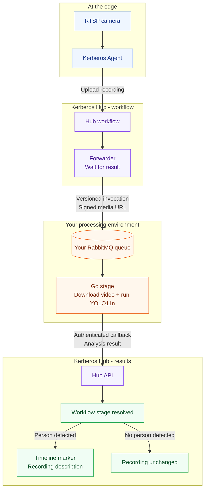
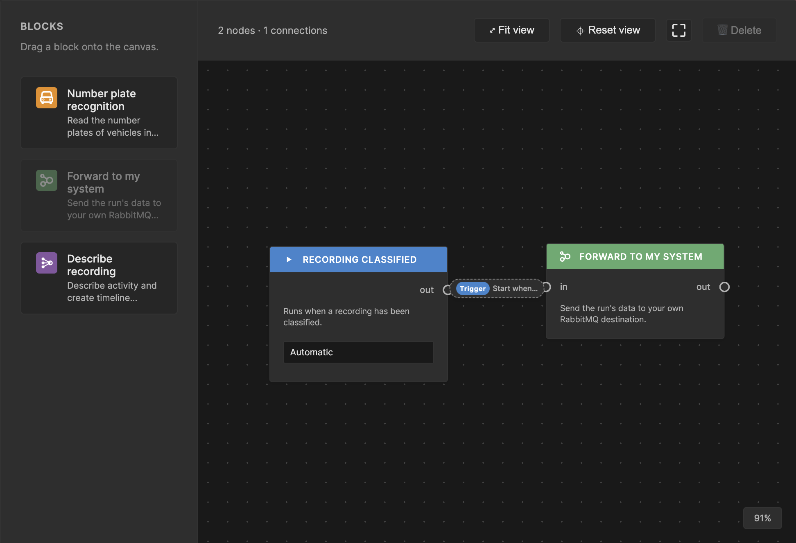
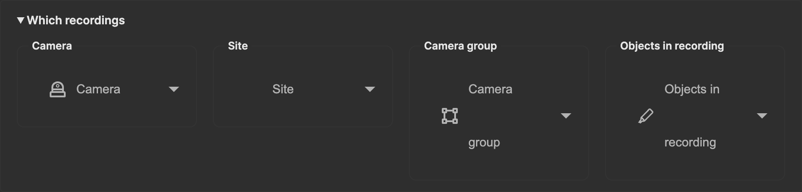
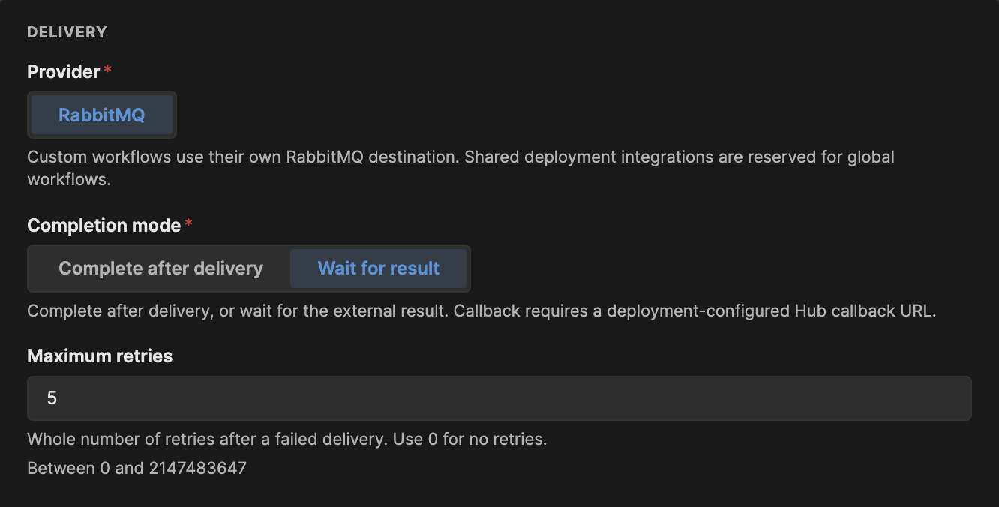
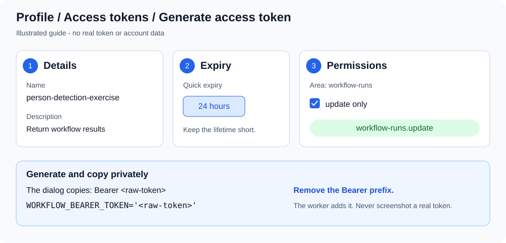

# Augment Vision Workflow Exercise

## Goal of the exercise

The goal of this exercise is to help a learner understand the complete Augment
Vision product flow: how video is captured at the edge, stored and orchestrated
through Hub, processed by a custom machine-learning stage, and enriched with
structured feedback that makes recordings searchable and filterable.

By completing the exercise, the learner should be able to:

- explain how Agent, Hub, workflows, RabbitMQ, custom processing stages, and
  workflow callbacks fit together;
- configure and run a working end-to-end workflow;
- process a Hub recording with a custom ML model;
- return markers and media metadata to Hub;
- understand how those results support timeline review, search, and filtering;
  and
- identify the contracts, runtime behavior, and operational concerns needed to
  build production features at Augment Vision.

This is a guided but deliberately open-ended exercise. The repository already
contains a working person-detection example; the learner should first configure
it and verify the complete flow before changing it. The example is a starting
point, not the final assignment.

Once the baseline works, learners can adapt the processing logic to a use case
of their choice. For example, they might:

- count people in a recording;
- add a counting line and report how many people cross it;
- detect cars or another object class;
- identify a domain-specific event; or
- produce different markers and searchable recording metadata.

The important outcome is not one particular model. It is understanding how to
integrate custom computer-vision logic into the Augment Vision platform and
feed useful, structured results back into Hub.

## Working reference implementation

The included Go stage demonstrates the complete flow:



It downloads a recording from the signed URL in a workflow invocation, runs
YOLO11n person detection, and submits the result to Hub. The implementation is
ready to run once the Agent, workflow designer, forwarder destination,
recording interval, and Hub callback credentials are configured.

## Prerequisites

- Docker
- VS Code with the Dev Containers extension
- A Hub owner account for creating an access token, and permission to create
  workflows in the organisation/project containing your Agent (see Step 0)
- An active Hub plan assigned by your tutor
- An Agent public access key and private key provided by your tutor in Step 0
- An H.264 or H.265 RTSP camera stream
- A Hub deployment with the workflow designer and `forwarder` block enabled
- A RabbitMQ destination reachable by both the Hub forwarder and your
  development container, with credentials for each and permission to use the
  destination queues described in Step 2
- A publicly reachable HTTPS Hub API configured as the forwarder's callback base URL
- A Hub token with the `workflow-runs.update` scope (created in Step 3)

The dev container supports `amd64` and `arm64`. It installs Go, OpenCV, ONNX
Runtime, and the checksum-verified YOLO11n model.

## 0. Create your Hub account and request a plan

1. Open [app.kerberos.io](https://app.kerberos.io), create a Hub account, and
   sign in. Complete email verification if prompted.
2. Contact your tutor using the email address you registered with and request
   a **valid Hub plan for the exercise** and the **RabbitMQ destination
   details** needed in Step 2. The tutor needs to identify your account; do
   not send your account password.
3. The tutor will **assign the plan to your account** and **generate the
   credentials** needed to connect your Agent. Wait for the tutor to confirm
   that your plan is active and provide the credentials before continuing.
4. Confirm that you have:
   - the Hub API URI;
   - the Agent public access key and private key;
   - the organisation/project to use for the exercise; and
   - the site ID, if the tutor has assigned one.
5. Sign in again or refresh Hub after the tutor provisions access, and select
   the organisation/project they specified.

**Creating an account alone is not enough to start the exercise.** If the plan
or credentials are missing, contact your tutor before proceeding to Step 1.
Receive credentials through the tutor's approved private channel, and keep
them out of Git, screenshots, and logs.

The Agent keys are separate from your Hub account password, the RabbitMQ
credentials used in Step 2, and the scoped callback token you create yourself
in Step 3. Obtain the RabbitMQ destination details from your tutor before
configuring the forwarder; assigning a Hub plan does not configure that
external destination automatically.

## 1. Connect an Agent

After your tutor confirms access is ready, open **Devices** in Hub and select
**Add Agent**. Use the connection details and credentials supplied in Step 0:

- the Hub API URI;
- the public access key;
- the private key; and
- the site ID, when required.

Start an Agent after replacing the placeholders:

```bash
docker run -d --name introduction-agent --restart unless-stopped \
  -p 8080:80 \
  -e AGENT_NAME=introduction-agent \
  -e AGENT_KEY=introduction-agent-<your-name> \
  -e AGENT_CAPTURE_IPCAMERA_RTSP='******camera/stream' \
  -e AGENT_CAPTURE_CONTINUOUS=true \
  -e AGENT_CLOUD=s3 \
  -e AGENT_HUB_URI='https://api.example.com' \
  -e AGENT_HUB_KEY='<public-access-key>' \
  -e AGENT_HUB_PRIVATE_KEY='<private-key>' \
  kerberos/agent:latest
```

Add `-e AGENT_HUB_SITE='<site-id>'` when a site is assigned. Use a unique
`AGENT_KEY`; Hub uses it as the stable device identity.

Open [http://localhost:8080](http://localhost:8080). The default local Agent
credentials are `root` / `root`; change them before exposing the UI outside
your machine.

Verify that:

1. the camera preview works
2. the Agent appears online in Hub
3. a recording made by the Agent is playable in Hub

See the
[Agent installation tutorial](https://doc.kerberos.io/tutorials/agent/install/)
and
[camera connection tutorial](https://doc.kerberos.io/tutorials/agent/connect-any-camera/)
for additional setup options.

## 2. Design the workflow in Hub

### Create and connect the blocks

1. Select the organisation/project containing your Agent and open **Workflows**.
2. Select **Add Workflow**, give it a name such as `Person detection exercise`,
   and add a short description. Leave it **Disabled** while configuring it.
3. The new canvas already contains the **Recording classified** start block.
   Keep its start mode **Automatic** so classified recordings can start the
   workflow.
4. Drag **Forward to my system** from **Blocks** onto the canvas to the right
   of the start block. Its display name is deployment-configurable; the
   operation must be `forwarder`.
5. Drag from the start block's right-hand output port to the forwarder block's
   left-hand input port. The connection determines execution order; placing
   blocks next to each other does not connect them.
6. Select the connection's **Start when...** trigger badge, not the forwarder
   block, to configure the automatic trigger. Expand **Which recordings** and
   use **Camera** to select only your exercise Agent. Leave **Site**,
   **Camera group**, and **Objects in recording** unset. Keep optional
   **Activity**, **Camera details**, and **Extra conditions** filters unset,
   and use **Active hours → Always** for the schedule.

Device selection and scheduling belong to the connection leaving an automatic
start block. Leaving the device selection empty includes every device in scope.
Do not add a `person` classification filter for the baseline: the exercise's
own YOLO model should analyze both person and no-person recordings.



*The live Hub designer with an unsaved example. Connect the two ports before
configuring the trigger.*



*Choose your own Agent under Camera. The screenshot intentionally leaves camera
selection empty so no account-specific device names are published.*

For a compact overview of the configuration, see the
[illustrated workflow guide](docs/images/workflow-designer.svg).

### Configure the forwarder destination

Select **Forward to my system** to open its settings. Custom workflows use
their own RabbitMQ destination; shared deployment integrations are reserved
for global workflows. Enter your destination details explicitly rather than
relying on the deployment's broker or credentials.

**Ask your tutor for the RabbitMQ information before filling in these settings:**

- **Host** (broker hostname) and **Port**
- your assigned **Queue** and **Virtual host**
- **Username** and **Password** for the forwarder
- whether **Use TLS** must be enabled
- the worker's consumer credentials, if different from the forwarder's
- the destination dead-letter queue name, and whether both queues are already
  provisioned or the forwarder is allowed to declare them

Receive passwords through the tutor's approved private channel. Do not use
your Hub account password or Agent keys as RabbitMQ credentials.

**Fill in the highlighted fields:** **Host** (your RabbitMQ hostname), **Port**,
**Queue**, **Username**, and **Password** are required before enabling the
workflow. Use the destination broker values supplied by your tutor; the
illustration uses placeholders, not credentials to copy. Confirm **Virtual
host** too: use `/` only if the tutor confirms that it is your assigned
virtual host.

| Forwarder setting | Exercise setting | Corresponding worker setting |
| --- | --- | --- |
| **Provider** | **RabbitMQ** (`broker=rabbitmq`) | The worker consumes RabbitMQ |
| **Completion mode** | **Wait for result** (`mode=callback`), not **Complete after delivery** | `RESULT_MODE=http` for the final run |
| **Maximum retries** | Keep `5` for the baseline; this limits retries of failed forwarder delivery, not worker processing | No matching worker setting |
| **Host**, **Port** | Destination broker hostname and port, e.g. `broker.example.com`, `5671` | `RABBITMQ_HOST=broker.example.com:5671` |
| **Queue** | Destination queue, e.g. `person-detection-exercise` | `STAGE_QUEUE=person-detection-exercise` |
| **Virtual host** | Destination virtual host, commonly `/`; blank uses `/`, not the deployment virtual host | `RABBITMQ_VHOST=/` |
| **Use TLS** | Enabled outside an approved trusted local network | `RABBITMQ_SCHEME=amqps` |
| **Declare destination queues** | Enabled if the forwarder's credentials may create durable quorum queues; otherwise have the administrator provision both queues first | The worker never declares queues |
| **Destination dead-letter queue** | A different queue from **Queue**; blank uses `<queue>.forwarder-dead-letter` | No matching worker setting |
| **Username**, **Password** | Your destination credentials, permitted to publish and declare/check queues as configured; deployment credentials are never used | `RABBITMQ_USERNAME`, `RABBITMQ_PASSWORD`: credentials permitted to consume |



*Wait for result is the UI label for callback mode. No destination credentials
are shown.*

The forwarder and worker must use the same broker, queue, virtual host, and TLS
configuration. They can use separate publisher and consumer credentials.
`STAGE_OPERATION=forwarder` matches the operation, not the workflow name or
block label.

In **Wait for result** (`callback`) mode, Hub waits for your stage to return
its result. In **Complete after delivery** (`delivered`) mode, forwarding the
message completes the stage immediately and
the invocation has no callback block, so it cannot demonstrate this exercise's
result-ingestion loop. The administrator must also configure
`FORWARDER_CALLBACK_BASE_URL` to the public HTTPS Hub API base URL; you do not
enter your Hub access token in the forwarder block.

Do not use Hub's internal engine/stage queue as the external destination. The
worker consumes the safe, versioned invocation from **your destination queue**,
not an internal `WorkflowRun`. It deliberately does not create queues, exchanges,
or bindings, and requires consumer read access but no broker management or
publish permissions. If **Declare destination queues** is disabled, both the
destination and destination dead-letter queue must already exist. If enabled,
the forwarder creates durable quorum queues when missing; existing queues must
be compatible with those declarations. Provision them with the administrator
or use credentials allowed to declare them.

For a new custom destination, **Declare destination queues** takes effect when
the forwarder dispatches the first invocation, not when you save the workflow.
The worker cannot start consuming a nonexistent queue. Step 6 covers both
pre-provisioned queues and first-delivery queue creation.

The destination dead-letter queue setting only creates or checks that queue.
It does not automatically route failed external-consumer messages there;
configure dead-letter routing separately on the broker or consumer. Never use
Hub's internal failed-dispatch queue as the external dead-letter destination.

Select **Create workflow** to save the disabled draft. No downstream block is
needed: returning the result to Hub completes this single-stage workflow.
Enable it and select **Save changes** only when the worker is configured and
you are ready to test in Step 6.

If the forwarder is missing from **Blocks**, the administrator must enable the
service and expose its operation in the workflow catalog. A deployment-managed
workflow opens read-only; duplicate it to create an editable workflow instead.
See the [external-stage reference](https://learn.uug.ai/docs/hub/workflows/external-stages/)
for deployment configuration and contracts.

## 3. Create the Hub access token

The callback token is separate from your Agent keys and RabbitMQ credentials.
Create it for the owner whose organisation/project contains the workflow and
recording.

1. Open your Hub **Profile** page (`/profile`) and select **Access tokens**
   (`/profile?tab=access-tokens`).
   This section is currently shown for owner accounts. If it is absent, have
   the appropriate owner create a narrowly scoped token for the exercise.
2. Select **Generate access token**.
3. In **Details**, enter a name such as `person-detection-exercise` (at least
   three characters) and a description such as `Return person-detection workflow results`.
   Both are required.
4. In **Expiry**, choose a short lifetime that covers the exercise, such as
   **24 hours**, or select an exact expiry date.
5. In **Permissions**, select the **`workflow-runs`** area and check only
   **`update`**. Confirm that **Assigned permissions** contains exactly
   **`workflow-runs.update`**. Do not select all permissions.
6. Select **Generate** and copy the token from the success dialog before closing
   it. Store it privately; treat it as a secret.



The dialog's copy control includes the `Bearer ` prefix for use in an HTTP
Authorization header. **Remove that prefix** when setting
`WORKFLOW_BEARER_TOKEN`: the exercise worker adds it itself. In your ignored
`.env` file, use only the raw token. The illustrated guide above summarizes
that distinction:

```dotenv
WORKFLOW_BEARER_TOKEN='<raw-token-without-Bearer-prefix>'
```

The permission is plural: `workflow-runs.update`, not `workflow-run.update`.
The token must belong to the correct tenant, be unexpired, and authorize the
run being completed. Do not put it in the workflow settings, commit it, or
include it in screenshots. Delete the exercise token from **Access tokens**
when finished; if it is exposed, revoke or rotate it before continuing.

## 4. Open the development environment

Open this repository as the VS Code folder and run:

**Dev Containers: Rebuild and Reopen in Container**

Use **Rebuild**, not only **Reopen**, after pulling changes to the
[dev-container Dockerfile](.devcontainer/Dockerfile). The build installs:

- OpenCV 4.6 for video decoding
- ONNX Runtime 1.29
- the official YOLO11n ONNX model
- Go module dependencies

The model and runtime downloads are pinned by SHA-256 checksums.

The container does not start an Agent, RabbitMQ, or a background worker. Run
the Agent on the Docker host and start the worker explicitly.

Running outside the dev container requires Go 1.25.8+, OpenCV 4.6, ONNX Runtime
1.29, and a compatible YOLO11n ONNX model. The dev container is the recommended
environment.

## 5. Configure the stage

Copy the example environment file:

```bash
cp .env.example .env
```

The `.env` file is ignored by Git. Never commit it or include its values in
logs, screenshots, or support messages.

### Quote credentials safely

Keep credential values inside single quotes, as in the example file. Replace
these placeholders with your own values:

```dotenv
RABBITMQ_USERNAME='your-consumer-username'
RABBITMQ_PASSWORD='your password with $ # and spaces'
WORKFLOW_BEARER_TOKEN='your-raw-Hub-token'
```

The VS Code profiles read environment-file values; the CLI commands below
**execute the file as shell input**. With single quotes, dollar signs, spaces,
and `#` remain literal in both paths. Keep the shared file to assignments and
comments, not commands or shell quote-concatenation expressions.

If a password contains a literal single quote, leave `RABBITMQ_PASSWORD=''`
in the shared file and use the CLI path. After loading the file, but before
`go run`, enter the password without echoing it:

```bash
read -r -s -p 'RabbitMQ password: ' RABBITMQ_PASSWORD
printf '\n'
export RABBITMQ_PASSWORD
```

This Bash prompt preserves the entered characters without evaluating them.
It is CLI-only: a VS Code profile does not receive this shell's override.
Use the same approach for another credential if needed, with its variable name.

| Variable | Description |
| --- | --- |
| `RABBITMQ_SCHEME` | `amqps` for TLS; use `amqp` only on an approved trusted network |
| `RABBITMQ_HOST` | Broker hostname and port |
| `RABBITMQ_USERNAME`, `RABBITMQ_PASSWORD` | Broker credentials |
| `RABBITMQ_VHOST` | Assigned virtual host, commonly `/` |
| `STAGE_QUEUE` | Existing queue that receives workflow invocations |
| `STAGE_OPERATION` | Operation expected in `stage.operation`; defaults to `forwarder` |
| `MARKER_START_TIMESTAMP` | Required recording start in Unix seconds; obtain it using the procedure below |
| `MARKER_DURATION_SECONDS` | Marker interval in seconds; `1..3600`, default `30` |
| `YOLO_MODEL` | YOLO11n ONNX model path |
| `ONNXRUNTIME_SHARED_LIBRARY` | ONNX Runtime shared-library path |
| `YOLO_CONFIDENCE` | Person confidence threshold in `(0, 1]`; default `0.5` |
| `YOLO_SAMPLE_FPS` | Frames analyzed per second in `(0, 30]`; default `1` |
| `RESULT_MODE` | `preview`, `bypass`, or `http` |
| `WORKFLOW_BEARER_TOKEN` | Raw Hub token with `workflow-runs.update`, without the `Bearer ` prefix; required in HTTP mode |
| `LOG_LEVEL` | Logrus level; default `info` |
| `LOG_OUTPUT` | `text` or `json`; default `text` |

### Obtain the recording timestamp

Use one known, playable recording from your exercise Agent:

1. Open that recording's detail page in Hub.
2. Open your browser's developer tools, select **Network**, and filter to
   **Fetch/XHR**. Reload the recording detail page if necessary.
3. Select the successful `GET /media/<recording-id>` request. In **Response**,
   expand `data.media` and copy **`startTimestamp`**. It is already Unix
   **seconds**; do not multiply it by 1000. Note **`videoFile`** too so you can
   match the recording to the invocation's `media.key`.
4. Set `MARKER_START_TIMESTAMP` in `.env` to that integer. Set
   `MARKER_DURATION_SECONDS` to a whole-second interval within the clip
   (`1..3600`); shorten the default `30` for shorter clips.

Use your existing Hub browser login to inspect this response; the worker's
callback token does not need additional read permissions. Do not copy or
share request headers or signed URLs from developer tools.

The example file deliberately leaves the timestamp blank so startup fails
until you supply it. Do not use the response envelope's `metadata.timestamp`,
the workflow run's **Started** time, the current time, or the offline fixture's
synthetic `1700000000` for a live callback.

This timestamp is one value per worker process, not derived automatically
from each invocation. It is suitable for the one-recording exercise, not a
mixed-recording stream. The initial preview never posts a marker to Hub; after
previewing, **match its logged `media.key` to `videoFile` and update the timestamp
for that exact recording before the HTTP callback**. Reload the environment
and restart the worker after changing it. The example does not yet derive
entry and exit timestamps from a person track.

## 6. Run the stage

VS Code launch profiles are defined in
[.vscode/launch.json](.vscode/launch.json).

### Offline fixture

Replace the placeholder `media.signedUrl` in
[examples/workflow-invocation.json](examples/workflow-invocation.json) with a
reachable HTTP or HTTPS video URL no larger than 100 MiB.

Select **Stage: offline sample** in **Run and Debug**, or run:

```bash
MARKER_START_TIMESTAMP=1700000000 \
  go run . -input examples/workflow-invocation.json
```

Offline input always prints a local preview. It does not consume RabbitMQ or
call Hub. The timestamp in this command is synthetic and only for the offline
fixture; the VS Code profile uses the timestamp you set in `.env`.

### Prepare the destination queue

Use a fresh, dedicated exercise queue with no other consumers. Keep the
workflow disabled until configuration and the callback token are ready.
Choose the startup order that matches your broker:

- **Queues already exist:** have the administrator confirm both the destination
  and destination dead-letter queue exist in the correct virtual host, with
  compatible settings and permissions. Start **Stage: queue preview** first,
  then enable and save the workflow and trigger one test recording.
- **New queues, Declare destination queues enabled:** enable and save the
  workflow and trigger one test recording first. The forwarder creates the
  queues and publishes the invocation; it can wait there without a consumer.
  Confirm the queues exist before starting **Stage: queue preview**.
- **New queues, Declare destination queues disabled:** have the administrator
  provision both queues first, then follow the existing-queues path. Starting
  the worker or saving the workflow will not create them.

For the single-recording baseline, pause further capture after the test clip
has arrived. If you started the example Agent in Step 1, run
`docker stop introduction-agent` **on the Docker host** to pause that example
container temporarily. Do not stop an unrelated or production Agent.

Before the HTTP step, confirm the dedicated queue contains only the test
invocation you previewed. If other recordings have queued, do not assume
`-once` will select your chosen recording: arrange an isolated test delivery
with the administrator instead of draining messages with bypass mode.

### Queue preview

Select **Stage: queue preview**, or run:

```bash
set -a
. ./.env
set +a
go run .
```

Follow the appropriate startup order under **Prepare the destination queue**.
A disabled workflow does not dispatch new work; an existing queue is required
before the worker can consume.

Preview mode:

1. receives one invocation
2. downloads and analyzes the recording
3. prints the generated result
4. requeues the RabbitMQ delivery
5. exits without calling Hub

Preview is not a broker peek. It changes redelivery state and may count toward
a configured delivery limit.

Note the preview's `runId` and the invocation's logged `media.key`. Look up that
exact recording using the timestamp procedure in Step 5 and update `.env` if
necessary. Keep the requeued invocation for the HTTP step; do not trigger a
second recording merely to switch modes.

### Queue bypass

Select **Stage: queue bypass** or set `RESULT_MODE=bypass`.

Bypass analyzes and prints each result, acknowledges the delivery, and does not
call Hub. It permanently removes successful messages from the queue without
resolving their workflow stages. Use it only for deliberate queue draining.

### HTTP callback

Set `WORKFLOW_BEARER_TOKEN` to the raw token from Step 3. Select **Stage: HTTP
callback** to process the same invocation that preview requeued. This profile
sets `RESULT_MODE=http` and `-once`, then exits after one acknowledged delivery.
The workflow was enabled during queue preparation; do not create a new run for
this step.

Before starting, confirm the queue contains only that test invocation, its
signed media URL is still valid, and `MARKER_START_TIMESTAMP` matches its
recording. For the command-line equivalent, set `RESULT_MODE=http` in `.env`,
reload it, and run:

```bash
set -a
. ./.env
set +a
go run . -once
```

If using an interactive credential override from Step 5, enter it again after
loading the file and before `go run`. The VS Code profile reads `.env` afresh
and overrides the file's default `preview` mode.

The worker calls the run-specific endpoint from the invocation:

```http
POST /workflows/runs/{runId}
Authorization: Bearer <token>
Content-Type: application/json
Idempotency-Key: <runId>:<operation>
```

Confirm the worker logs show the same `runId` you previewed and a successful
callback before moving to Hub verification. A `2xx` alone does not prove the
marker timestamp was correct.

## 7. Verify the result in Hub

1. Open **Workflows**, find your workflow, and select **View runs**, or open
   **Runs** and filter to it.
2. Open the run for your test recording. Confirm that the `forwarder` stage
   resolves after the worker's callback succeeds, rather than immediately after
   queue delivery.
3. Open the recording in Hub. For a clip containing a person, verify that the
   `person detected` marker appears at your configured interval and that the
   recording description contains the YOLO detection summary.
4. Repeat queue preparation, preview, timestamp lookup, and one-shot callback
   with a recording without a person. To resume the example Agent, run
   `docker start introduction-agent` on the Docker host, then pause it again
   after the next test clip. The run should finish, but no marker or
   recording-description change should be created by this stage.

Preview mode deliberately leaves the stage waiting: it never calls Hub.
After previewing an invocation, process that requeued delivery in HTTP mode
while its signed media URL and callback run remain valid, or create a fresh run.
If a fresh run is needed, repeat preview and timestamp verification before
posting. Do not process different recordings continuously with one fixed
`MARKER_START_TIMESTAMP`.

| Symptom | Check |
| --- | --- |
| No workflow run appears | Workflow is enabled and saved; automatic start is connected; the connection selects your Agent and uses an active schedule; trigger a fresh recording or re-analysis. |
| A run appears but nothing reaches your queue | Forwarder service, catalog operation, destination credentials, broker reachability, queue, virtual host, and TLS settings. |
| Worker says it cannot consume `STAGE_QUEUE` | Confirm the queue exists in that virtual host and the consumer has read permission. For a new destination with declaration enabled, first trigger the forwarder's delivery as described in queue preparation. |
| Invocation has no `callback.url` | Forwarder mode must be `callback`, with the public Hub API base URL configured. Do not use this invocation to verify callback completion. |
| Callback returns `401` or `403` | Raw token has no `Bearer ` prefix, is unexpired, belongs to the correct tenant, and has exactly `workflow-runs.update`. |
| Callback returns `409` | A different result already completed that run/stage; use a fresh run rather than changing an already accepted result. |
| Worker cannot download the recording | Signed URL is reachable from the dev container and has not expired; re-analysis creates a fresh invocation. |
| Marker appears at the wrong time | Copy `data.media.startTimestamp` for the previewed recording, match `videoFile` to the invocation's `media.key`, reload `.env`, and use a one-shot callback. The value is Unix seconds, not an offset or milliseconds. |

Disable and save the exercise workflow when finished so new recordings no
longer queue work for an unattended worker. Delete the exercise access token.

## Processing behavior

For each valid invocation, the worker:

1. validates the schema, run ID, stage operation, callback, media key, and
   marker interval
2. downloads `media.signedUrl` into memory with a two-minute timeout and a
   100 MiB limit
3. stages the bytes in a private temporary file because OpenCV video capture
   requires a filename
4. samples frames at `YOLO_SAMPLE_FPS`
5. runs YOLO11n until the first person confidence reaches
   `YOLO_CONFIDENCE`
6. submits one of the two result forms below

The temporary file is removed after processing. Signed URL credentials and
query parameters are redacted from logs.

### Person detected

Hub receives an ingest `payload` containing a marker and media patch:

```json
{
  "schema": "uug.ai/workflow-result/v1",
  "stage": {
    "operation": "forwarder"
  },
  "payload": {
    "blocks": [
      {
        "type": "marker",
        "data": {
          "siteId": "site-1",
          "organisationId": "org-1",
          "mediaKeys": ["recording.mp4"],
          "startTimestamp": 1700000000,
          "endTimestamp": 1700000030,
          "duration": 30,
          "name": "person detected",
          "description": "YOLO detected a person with 0.91 confidence after analyzing 3 sampled frames"
        }
      },
      {
        "type": "media-patch",
        "data": {
          "mediaKey": "recording.mp4",
          "description": "YOLO detected a person with 0.91 confidence after analyzing 3 sampled frames"
        }
      }
    ]
  }
}
```

The marker is linked directly to the recording through `mediaKeys`. The media
patch updates the recording description with the same deterministic detection
summary.

### No person detected

An ingest payload may not contain an empty block list. When no person meets the
threshold, the worker therefore sends a routing `result` instead:

```json
{
  "schema": "uug.ai/workflow-result/v1",
  "stage": {
    "operation": "forwarder"
  },
  "result": {
    "framesAnalyzed": 30,
    "personDetected": false
  }
}
```

This resolves the workflow stage without creating a marker or changing the
recording description.

## Delivery and retry semantics

- RabbitMQ uses explicit acknowledgements with a prefetch of one
- Preview always requeues its delivery
- HTTP mode acknowledges only after a `2xx` callback response
- Timeouts, redirects, authorization errors, and other non-`2xx` responses
  requeue the delivery and stop the worker
- Malformed invocations and processing failures also requeue and stop, avoiding
  an immediate retry loop
- Ctrl+C and broker disconnections leave unacknowledged deliveries for
  RabbitMQ recovery
- Callback redirects are not followed
- Callback HTTP is allowed only for loopback testing; other endpoints require
  HTTPS

If an invocation omits `callback.url`, HTTP mode prints the result and
acknowledges the delivery, but the workflow stage remains unresolved.

## Security

- Keep Agent, RabbitMQ, storage, and Hub credentials out of Git
- Use a Hub token scoped only to `workflow-runs.update`
- Use TLS for RabbitMQ and callbacks outside an approved local test network
- Do not disable certificate validation
- Signed URLs, embedded URL credentials, tokens, passwords, storage fields
  and private keys are redacted from structured invocation logs
- Callback bodies are rebuilt from validated fields instead of echoing the
  invocation
- Media downloads are bounded to 100 MiB
- The model and ONNX Runtime archives are checksum verified during the
  dev-container build

## Project layout

| Path | Purpose |
| --- | --- |
| [main.go](main.go) | Executable entry point |
| [internal/app/worker.go](internal/app/worker.go) | RabbitMQ consumption and acknowledgement lifecycle |
| [internal/app/persondetection.go](internal/app/persondetection.go) | Invocation validation, media download, and result construction |
| [internal/app/yolo.go](internal/app/yolo.go) | GoCV video sampling and Go ONNX inference |
| [internal/app/support.go](internal/app/support.go) | Configuration, callback validation, and HTTP submission |
| [internal/app/logging.go](internal/app/logging.go) | Structured logging and credential redaction |
| [examples/workflow-invocation.json](examples/workflow-invocation.json) | Offline invocation fixture |
| [.devcontainer/Dockerfile](.devcontainer/Dockerfile) | OpenCV, ONNX Runtime, and YOLO model environment |

## Testing

Run:

```bash
go test ./...
go vet ./...
```

The test suite covers:

- invocation and callback validation
- signed-media download behavior and limits
- YOLO tensor preprocessing and person-score extraction
- marker and media-patch payloads
- no-person routing results
- callback success and failure handling
- RabbitMQ acknowledgement and requeue behavior
- credential redaction

An opt-in integration test exercises real video decoding and YOLO inference:

```bash
YOLO_MODEL_INTEGRATION="$YOLO_MODEL" \
ONNXRUNTIME_SHARED_LIBRARY_INTEGRATION="$ONNXRUNTIME_SHARED_LIBRARY" \
  go test ./internal/app -run TestYOLOModelIntegration -v
```

## Extend the exercise

The baseline now includes designing the workflow, configuring the forwarder,
creating the callback token, and verifying the result in Hub. Once it works,
further stage improvements could include:

- person tracking across frames
- exact entry and exit timestamps
- persisted bounding-box tracks
- configurable marker descriptions
- production tuning for camera placement, confidence, and sampling rate

Useful references:

- [Custom workflow stage tutorial](https://learn.uug.ai/tutorials/hub/custom-workflow-stage/)
- [Marker contract](https://learn.uug.ai/docs/hub/workflows/ingest/blocks/marker/)
- [Production reference service](https://github.com/uug-ai/hub-loitering)

## Completion checklist

- [ ] Hub account is created and the tutor has assigned an active exercise plan.
- [ ] Tutor-provided Agent credentials and the correct organisation/project are available.
- [ ] Tutor-provided RabbitMQ connection details, credentials, and queue provisioning instructions are available.
- [ ] Agent camera preview works.
- [ ] Agent is online in Hub.
- [ ] A recording is playable in Hub.
- [ ] Workflow connects an automatic start block to the `forwarder` block.
- [ ] The start connection selects only the exercise Agent and uses an active schedule.
- [ ] Forwarder uses the correct external destination queue and `callback` mode.
- [ ] Both destination queues exist before the worker starts consuming.
- [ ] Workflow is saved and enabled for the test.
- [ ] Dev container has been rebuilt successfully.
- [ ] `go test ./...` passes.
- [ ] Queue preview analyzes and requeues a real invocation.
- [ ] Credential values are safely quoted, or supplied through a CLI-only prompt.
- [ ] The queued test invocation is isolated; its `media.key` matches the recording used for `MARKER_START_TIMESTAMP`.
- [ ] The timestamp was copied from `data.media.startTimestamp` in Unix seconds, and the interval fits the clip.
- [ ] Hub token has only `workflow-runs.update`; `.env` contains the raw token.
- [ ] The one-shot HTTP callback uses the previewed `runId` and returns `2xx`.
- [ ] The run's `forwarder` stage resolves in Hub.
- [ ] A person detection creates a marker and updates the recording description.
- [ ] A no-person result resolves the workflow without changing the recording.
- [ ] Exercise workflow is disabled and the exercise token is deleted after testing.
